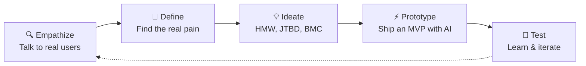

<!-- ============================================================
  GITHUB PROFILE README — Nuzul Nur Robbulizzat (Nerzularc)
  1. Create a public repo named EXACTLY like your username (Nerzularc/Nerzularc)
  2. Put this file at the root as README.md
  3. Put snake.yml at .github/workflows/snake.yml (for the snake animation)
  4. Replace "Nerzularc" in URLs if your username differs
============================================================ -->

<!-- ===== HEADER ===== -->
<p align="center">
  
</p>

<p align="center">
  <a href="https://git.io/typing-svg">
    
  </a>
</p>

<p align="center">
  <a href="https://linkedin.com/in/nuzulnurri"></a>
  <a href="mailto:nerzularc@gmail.com"></a>
  
</p>

<p align="center">
  <a href="#-about-me">About</a> •
  <a href="#-featured-projects">Projects</a> •
  <a href="#-how-i-build">How I Build</a> •
  <a href="#%EF%B8%8F-tech-stack">Stack</a> •
  <a href="#-github-activity">Activity</a> •
  <a href="#-lets-work-together">Contact</a>
</p>

---

## 🧑‍💻 About Me

```js
const nuzul = {
  aka:         "Nerzularc",
  studying:    "Information Systems @ Institut Teknologi Sepuluh Nopember (ITS)",
  basedIn:     "Surabaya, Indonesia 🇮🇩",
  building:    ["AI-powered web apps", "Digital products", "Marketing tools"],
  focus:       "Real problems in the Indonesian market",
  approach:    "Design thinking → fast MVP → iterate",
  ecosystem:   ["Shopee", "TikTok Shop", "Tokopedia", "Gumroad", "Lynk.id"],
  languages:   ["Bahasa Indonesia", "English"],
  lookingFor:  ["Remote internships", "Freelance projects", "Collaborations"],
};
```

---

## 🚀 Featured Projects

> 👇 **Click a project to expand it**

<details>
<summary><b>🛡️ MitraCek</b> — Check a franchise / SME offer before you invest</summary>
<br>

**Problem:** Prospective SME and franchise partners often commit money without a clear picture of feasibility or risk.

**What it does:**
- 🧮 Calculates business feasibility
- ⚖️ Compares partnership packages side by side
- ✅ Walks users through a due-diligence checklist

**Built with:** `HTML` `JavaScript` · Design thinking (personas, JTBD, empathy map, BMC)
</details>

<details>
<summary><b>📋 TenderCek</b> — Eligibility checker for government tenders</summary>
<br>

**Problem:** Small contractors get disqualified from government tenders (SPSE/INAPROC) over requirements they could have caught earlier.

**Idea:** Check tender requirements *before* submitting. Inspired by the Gara Facile hackathon project from Italy.

**Stage:** Product research — user persona, pain & gain, JTBD, value proposition, HMW
</details>

<details>
<summary><b>📝 TWK Tryout Simulator</b> — AI-generated civil service exam practice</summary>
<br>

**What it does:**
- 🤖 Generates story-based exam questions with AI
- ⚙️ Configurable quiz settings and scoring
- 🔁 Handles truncated AI output with smaller batches plus retry/repair logic

**Built with:** `React` `Anthropic API`
</details>

<details>
<summary><b>💡 AI Arthomic</b> — AI business idea generator</summary>
<br>

Generates business ideas with AI, wrapped in a cyberpunk aesthetic.

**Built with:** `React` `Anthropic API`
</details>

<details>
<summary><b>💬 AI Chat (WhatsApp-style)</b> — Familiar chat UI, AI inside</summary>
<br>

An AI chat app prototype with a WhatsApp-like interface, exploring phone number login/OTP flows.

**Built with:** `React` `Groq API`
</details>

<details>
<summary><b>🎯 JAGO AI DALAM 14 HARI</b> — Landing page for an AI course</summary>
<br>

Full landing page for an AI skills course, from copywriting to design, refined through several iterations.

**Built with:** `HTML` `CSS` · Copywriting
</details>

---

## 🧭 How I Build



---

## 🛠️ Tech Stack

<p align="center">
  <a href="https://skillicons.dev">
    
  </a>
</p>

<p align="center">
  
  
  
  
</p>

<details>
<summary><b>📈 Marketing & Business Skills</b> (click to expand)</summary>
<br>

| Area | What I do |
|---|---|
| 📣 Digital Marketing | Meta (Facebook/Instagram) ad strategy, TikTok content, Gen Z marketing psychology |
| 📊 Market Analysis | TAM-SAM-SOM, STP, competitor mapping |
| 🧩 Business Design | Business Model Canvas, Value Proposition, JTBD |
| ✍️ Copywriting | Landing pages, ads, product descriptions |
| 🛒 E-commerce | Shopee, TikTok Shop, Tokopedia, Gumroad, Lynk.id |

</details>

---

## 📊 GitHub Activity

<p align="center">
  
</p>

<!-- Snake eating your contribution graph — needs .github/workflows/snake.yml -->
<p align="center">
  <picture>
    <source media="(prefers-color-scheme: dark)" srcset="https://raw.githubusercontent.com/Nerzularc/Nerzularc/output/github-contribution-grid-snake-dark.svg" />
    
  </picture>
</p>

---

## 🤝 Let's Work Together

<table align="center">
  <tr>
    <td align="center">💼<br><b>Remote Internship</b><br><sub>Product · BA · Growth</sub></td>
    <td align="center">🛠️<br><b>Freelance</b><br><sub>AI MVPs · Landing pages</sub></td>
    <td align="center">📣<br><b>Marketing</b><br><sub>Strategy · Content · Ads</sub></td>
    <td align="center">🔬<br><b>Research</b><br><sub>Market · User · Consulting</sub></td>
  </tr>
</table>

<p align="center">
  <a href="https://linkedin.com/in/nuzulnurri"><b>👉 Message me on LinkedIn</b></a>
</p>

<!-- ===== FOOTER ===== -->
<p align="center">
  
</p>
